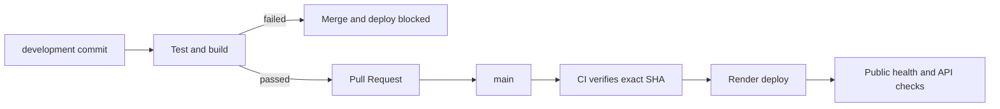
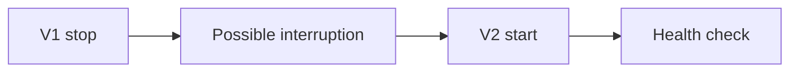
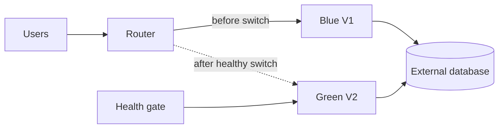
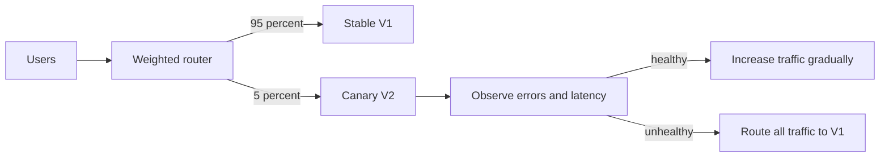

# Міндетті A B C D E тапсырмалары

Бұл талдау кодпен және `evidence/` дәлелдерімен бірге қаралады. Жергілікті тәжірибені бұлтта орындалған әрекет ретінде көрсетуге болмайды.

## A Деректердің сақталуы

Бастапқы Python dictionary әр процестің жедел жадында ғана болады. Процесс тоқтағанда жойылады. Gunicorn екі worker-пен жұмыс істегенде әрқайсысының dictionary-і және next_id есептегіші бөлек: өтінім бір worker-де жасалып, екіншісінде табылмауы мүмкін.

Осы жобада `STORAGE_BACKEND=memory` бастапқы мінез-құлықты зерттеуге қалдырылған. Негізгі сақтау — SQLAlchemy арқылы SQLite; өндірістік орта сыртқы PostgreSQL-ды міндеттейді. DB автоматты бүтін ID мен транзакцияны қолданады, сондықтан әр worker бір қоймамен жұмыс істейді.

Жергілікті нақты процестерді қайта іске қосу memory деректерін жоғалтатынын, SQLite файлы өзгермесе деректер сақталатынын көрсетті. Нәтиже: `evidence/experiments.json`.

SQLite файлы PaaS-тың ephemeral filesystem-інде орналасса, redeploy кезінде жоғалуы мүмкін. Сыртқы PostgreSQL қосымша процесінен тәуелсіз. Render Blueprint DB байланысын `DATABASE_URL` арқылы береді. PostgreSQL-дың бұлтта қайта орналастырудан кейін сақталуы тек нақты URL, ID және қайта оқылған JSON арқылы расталады.

## B Нұсқаларды басқару

Жұмыс ағыны: development → CI → Pull Request → required checks → main → deployment. Қате тесттің exit code-ы 1; CI job failed болады. Branch protection required check өтпесе біріктіруге жол бермейді. Render `checksPass` режимі main CI сәтті аяқталуын күтеді. Main-ға тек тексерілген PR біріктіріледі; конфигурациялық Blueprint sync өзгерісі де осылай тексеріледі.

Local branch немесе merge GitHub Pull Request-ті алмастырмайды. Репозиторий, PR, сәтсіз және сәтті workflow сілтемелері нақты нәтижелер есебіне жазылады.

## C Қауіпсіз конфигурация

| Параметр | Development | Test | Production |
|---|---|---|---|
| APP_ENV | development | test | production |
| Қойма | SQLite file | жеке memory/SQLite | сыртқы PostgreSQL |
| DATABASE_URL | міндетті емес | tmp_path DB | PaaS Secret |
| PORT | 8000 | бос жергілікті порт | PaaS берген PORT |
| Сервер | Flask local | Flask test/process | Linux Gunicorn |

Құпиялар кодта жоқ. `.env`, `.env.*`, DB файлдары және журналдар Git пен Docker context-тен шығарылған; тек қауіпсіз `.env.example` Git-те бар. Скрипттер құпия мәндерді логқа шығармайды. Request журналы method, path, status, duration ғана сақтайды; body, Authorization, query string, DB URL жазылмайды.

Контейнерде UID 10001 қолданылады. Root-та орындалған қате не осалдық артық құқық алуы мүмкін; non-root ықпалын азайтады. Compose web контейнері read-only, capabilities алынып тасталған, privilege escalation шектелген. PostgreSQL порты хостқа жарияланбайды. Жергілікті web порты тек 127.0.0.1-ге байланған; PaaS reverse proxy HTTPS арқылы сервиске бағыттайды.

Бұл оқу API-інде пайдаланушы аутентификациясы жоқ; нақты жеке/құпия дерек сақталмайды. Environment variable атауларын бөлу жеткіліксіз: production үшін жедел жад пен SQLite конфигурациясы startup-та қабылданбайды.

## D Ақауды диагностикалау

| Кезең | Нақты жергілікті нәтиже |
|---|---|
| Қате | startup target модулі `labcloud_typo` |
| Журнал | ModuleNotFoundError No module named labcloud_typo |
| Процесс | exit code 1 |
| Себеп | startup командасындағы модуль атауы app.py-мен сәйкес емес |
| Түзету | дұрыс модуль `app`, production WSGI target `app:app` |
| Қайта тексеру | жаңа процесс ашылды, health HTTP 200, POST/GET өтті |

Дәлелдер: `D-startup-broken.log`, `http-release-2-fixed.log`, `experiments.json`. Бұл оқшауланған жергілікті диагностикалық тәжірибе. PaaS-та қате енгізу қажет болса, production-ға әсер етпейтін тест ресурсында оқытушы келісімімен орындалады.

Диагностика реті: соңғы deploy күйін қарау → startup журналы → HTTP журналы → PORT және APP_ENV мәндері → тәуелділік пен WSGI target → түзету → health және API қайта тексеруі. Құпия DATABASE_URL-ды экранға басып тексеруге болмайды.

## E Орналастыру стратегиялары

| Тәсіл | Қағида | Артықшылығы | Шектеуі |
|---|---|---|---|
| Қарапайым restart | ескісі тоқтайды, жаңасы іске қосылады | оңай, ресурс аз | қысқа үзіліс болуы мүмкін |
| Blue Green | екі орта, health өткен соң traffic ауысады | жылдам rollback | екі ортаға ресурс, DB үйлесімділігі қажет |
| Canary | жаңа нұсқаға аз үлес traffic, кейін өсіру | нақты traffic-та тәуекелді бақылау | weighted routing және өлшемдер керек |

Қарапайым қайта орналастыру:

Blue Green принципі:

Canary принципі, бұл жобада іске асырылды деп мәлімделмейді:

Render құжаттамасына сәйкес persistent disk жалғанбаған сервисте zero-downtime deploy бар: жаңа instance дайын және health тексеруінен өткен соң traffic ауыстырылады. Бұл Blue Green идеясына ұқсас, платформа басқаратын ауысу; жобада қолмен екі орта құрылғаны туралы мәлімдеме жоқ. Ескі commit-ке rollback жасауға болады. Persistent disk бар сервис үшін zero-downtime шектеуі бар. [Render deploys](https://render.com/docs/deploys), [Health checks](https://render.com/docs/health-checks).

Осы шағын жоба Render-дің қалыпты health-gated deploy тәсіліне дайындалды. Сыртқы PostgreSQL persistent web disk қажеттілігін жояды. Қаралған ресми құжаттарда стандартты web service үшін пайдаланушы баптайтын пайыздық Canary traffic бөлуі көрсетілмеген; оны native supported немесе орындалды деп көрсетпейміз. Мұндай стратегия үшін бөлек router және екі сервис қажет болуы мүмкін. DB схемасының өзгерісі ескі және жаңа нұсқамен де үйлесімді болуы тиіс.

## Бастапқы талдау сұрақтарының жауаптары

`PORT` санын тұрақты бекітсек, PaaS берген портпен сәйкес келмеуі мүмкін; reverse proxy және health check сервиске жете алмайды. `0.0.0.0` барлық контейнер интерфейстеріне тыңдауды қосады; `127.0.0.1` тек сол контейнердің loopback адресіне қызмет көрсетеді.

`EXPOSE 8000` — бейненің құжаттамалық метадерегі. Ол host firewall-ды ашпайды және портты интернетке жарияламайды. Docker үшін `-p`, ал PaaS үшін platform routing қажет. Сыртқы HTTPS 443 портын PaaS proxy қабылдайды, қосымша ішкі PORT-та жұмыс істейді.

Image — файлдар мен іске қосу конфигурациясының өзгермейтін үлгісі. Container — сол image-ден жасалған орындалып жатқан процесс ортасы және writable layer. Memory процеске тәуелді; SQLite container layer-іне тәуелді; PostgreSQL сыртқы DB lifecycle-іне тәуелді. Restart кезінде SQLite сол контейнерде сақталуы мүмкін, бірақ контейнерді қайта жасау volume-сыз оны жоғалтады.
